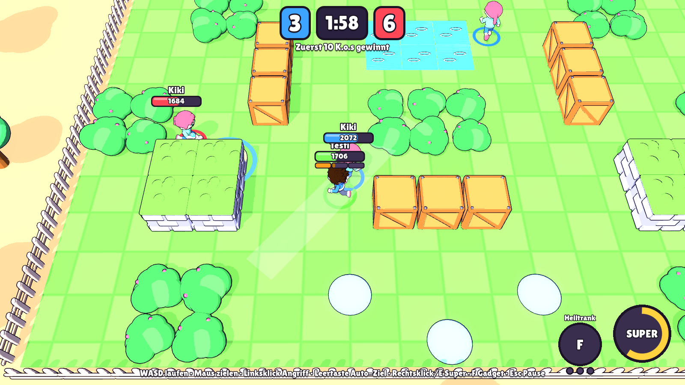

# 💥 KRAWALL CREW

3D-Arena-Brawler im Comic-Stil: 3 gegen 3, schräg von oben, kurze schnelle Runden.
Alle Kämpfer sind **echte Personen**, die du einbringst. Sie werden in Blender als animierte
Comic-Charaktere modelliert. Neue Kämpfer bekommt man aus Laptops mit verschiedenen Seltenheiten.

## Spielen

1. [Godot 4.5](https://godotengine.org/download) installieren
2. In Godot **Importieren** → `krawall/spiel/project.godot` wählen → **F5**

**Steuerung (PC):** WASD laufen · Maus zielen · Linksklick Angriff · Leertaste Auto-Ziel ·
Rechtsklick/E Super · Esc Pause. Gamepad geht auch.
**Handy/Tablet:** links Bewegungs-Stick, rechts Angriffs-Stick (ziehen = zielen, tippen = Auto-Ziel),
daneben der Super-Knopf.

**Modus „Krawall“:** Wer zuerst 10 K.o.s schafft, gewinnt (sonst nach 2:30 das Team mit mehr K.o.s).
Büsche verstecken dich, Kisten gehen mit Bomben-Supers kaputt, Wasser blockiert Laufen, aber nicht Schüsse.
Leben regeneriert sich, wenn du 3 s weder triffst noch getroffen wirst.

## Eigenen Charakter einbauen

Schick Claude Fotos und eine Beschreibung (Name, Kampfstil, Seltenheit, Fähigkeiten). Claude modelliert die
Figur in **Blender** (`blender/charakter_bauen.py` plus individuelle Anpassungen) und trägt alles in
`spiel/charaktere/<id>/charakter.json` ein. Anleitung und alle Felder: `spiel/charaktere/_vorlage/LIES_MICH.md`.

**Wie das Spiel funktioniert** (Laptops, Seltenheiten, Wahrscheinlichkeiten, Fähigkeiten): [GAMEPLAY.md](GAMEPLAY.md)

## Ordner

| Ordner | Inhalt |
|---|---|
| `spiel/` | Godot-Projekt (GL Compatibility: PC, Web, Handy) |
| `spiel/skripte/` | `arena.gd` Match & Karte · `kaempfer.gd` Kämpfer + Bot-KI · `hud.gd` Oberfläche · `menue.gd` Auswahl · `toon.gd` Comic-Materialien |
| `spiel/shader/` | Toon-Shader (Stufen-Licht, Randlicht), Umrisslinien, Boden |
| `spiel/charaktere/` | ein Ordner pro Charakter (`charakter.json` + `model.glb`) |
| `spiel/arena/objekte.glb` | Mauern, Kisten, Büsche, Wasser, Bäume, Zaun (aus Blender) |
| `blender/umgebung_bauen.py` | Arena-Objekte und der Laptop fürs Öffnen |
| `blender/charakter_bauen.py` | Charakter-Modellierer: Figur, Skelett, Animationen → `model.glb` |
| `werkzeuge/` | `neuer_charakter.py`: Charakter-Ordner anlegen |
| `spiel/daten/` | Seltenheiten, Laptops/Wahrscheinlichkeiten, Belohnungen (JSON) |

Blender-Skripte laufen mit installiertem Blender (`blender -b -P skript.py -- …`) oder mit dem
Python-Modul `pip install bpy` (`python3 skript.py …`).

Schrift: [Lilita One](spiel/schrift/OFL.txt) (SIL Open Font License).
